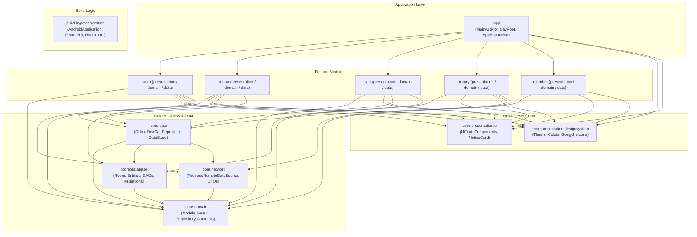

# 🧋 Koalacha (Gongcha 貢茶線上點餐與會員系統)

[](https://www.android.com/)
[](https://kotlinlang.org)
[](https://developer.android.com/build)
[-orange.svg)](https://developer.android.com/jetpack/compose)
[]()
[-yellow.svg)](https://firebase.google.com/)

**Koalacha** 是一款遵循現代 Android 開發架構規範打造的手搖飲線上點餐與數位會員 App。採用 **Multi-Module Clean Architecture**、**離線優先（Offline-First）** 策略與 **Jetpack Compose (MVI)**，提供門市選擇、飲品自訂、購物車管理、即時結帳、歷史訂單追蹤與數位會員卡服務。

---

## 📑 目錄

- [系統模組架構設計](#-系統模組架構設計)
- [已實現功能清單](#-已實現功能清單)
- [技術棧與函式庫](#-技術棧與函式庫)
- [資料庫與離線同步機制](#-資料庫與離線同步機制)
- [快速開始與環境設置](#-快速開始與環境設置)
- [未來擴充與功能建議 (Roadmap & Ideas)](#-未來擴充與功能建議-roadmap--ideas)

---

## 🏛 系統模組架構設計

專案採用 **模組化 Clean Architecture (Presentation - Domain - Data)**，搭配 Gradle **Convention Plugins (`build-logic`)** 統一建置規範，實現高度解耦、高可測試性與並行編譯加速。



### 模組職責說明

| 模組名稱 | 職責與描述 |
| :--- | :--- |
| **`:app`** | 應用程式進入點、啟動圖（Splash Screen）、全局導航骨幹（`NavRoot`、Type-Safe Routes）、浮動底部導航欄（`AppBottomBar`）與全域購物車計數監聽。 |
| **`:menu`** | 菜單與門市選取業務：門市切換檢核（購物車有品項時限制切換）、飲品種類分類切換、飲品規格客製化（冰量/甜度/配料/杯型）、加入購物車。 |
| **`:cart`** | 購物車模組：以 `userId` 隔離用戶購物車，支援增減數量防抖（Debounce）、刪除確認 Dialog、總金額計算與結帳。 |
| **`:history`** | 訂單歷史紀錄：即時/歷史訂單列表、訂單狀態顯示（`IN_ORDER` / `IN_PROGRESS` / `COMPLETED`）、取消訂單機制。 |
| **`:member`** | 會員中心模組：會員條碼展示、會員等級卡面（無等級/銅/銀/金牌視覺）、會員點數餘額、未登入導引視圖。 |
| **`:auth`** | 身份認證：整合 Android Credential Manager 與 Google Sign-In、匿名訪客登入（Anonymous Auth）、手機驗證碼驗證 UI 與驗證器。 |
| **`:core:domain`** | 純 Kotlin 領域層：定義核心領域實體（`User`, `Tea`, `Store`, `CartItem`, `History` 等）、`Result<D, E>`、`DataError` 與各 Repository 介面。 |
| **`:core:data`** | 實作 Repository：離線優先資料流 `OfflineFirstCartRepository`、使用者偏好設定 `DefaultAppDataStore`、`AuthRepositoryImpl`。 |
| **`:core:database`** | Room 資料庫引擎：`GongchaDatabase`、DAO、型別轉換器（Converters）、完整版本遷移腳本（Migrations 1 → 5）。 |
| **`:core:network`** | 雲端資料來源：`FirebaseRemoteDataSource`，封裝 Cloud Firestore CRUD 操作與例外轉換。 |
| **`:core:presentation:designsystem`** | 設計系統：Artisanal Washi & Tea 主題配色、Typography、向量圖標庫（`GongchaIcons`）、按鈕與晶片元件。 |
| **`:core:presentation:ui`** | 通用 UI 支援：UI 模型（`UiText`）、共用元件（`Counter`, `NoticeCard`）與事件流監聽工具（`ObserveAsEvents`）。 |
| **`build-logic`** | Gradle Convention Plugins 複合建置（Composite Builds），統一管理編譯設定、Compose 配置、Room 插件及依賴版本。 |

---

## 🚀 已實現功能清單

### 1. 身份認證與用戶管理 (Authentication & User Profile)
- [x] **Google 一鍵登入**：基於 Android 最新 `Credential Manager` 與 `google-id` 整合。
- [x] **訪客匿名登入**：支援免登入快速瀏覽，自動建置匿名 Firebase 訪客身分。
- [x] **手機號碼登入與驗證碼流程**：具備驗證碼輸入框、格式校驗器（`PhoneNumberValidator`）與倒數定時器。
- [x] **安全登出機制**：登出時清除 DataStore 本地快取、清空導航返回棧並回到登入流程。
- [x] **使用者資料隔離**：登入後自動同步 Firestore 用戶資料（名稱、頭像、等級、點數）。

### 2. 門市與菜單系統 (Stores & Menu)
- [x] **門市即時切換與持久化**：支援分區門市列表展示，記住最新選擇門市（`AppDataStore`）。
- [x] **切換門市保護鎖**：當購物車內尚有商品時，限制任意切換門市並彈出溫馨確認對話框，避免訂單混淆。
- [x] **未選門市提示動畫**：未選取門市時點選飲品觸發提示與引導動態。
- [x] **飲品分類篩選**：以可滑動 Chips 依類別篩選（原茶、奶香、特調、冰沙等）。
- [x] **離線快取同步機制**：以版本號（`versionCode`）比對機制進行增量同步，加速載入並支援無網路瀏覽。

### 3. 飲品客製化與點餐 (Tea Order Customization)
- [x] **共享元素轉場（Shared Element Transition）**：飲品卡片至點餐頁面使用平滑放大與過渡動畫。
- [x] **豐富客製化選項**：
  - 規格尺寸：中杯（M）、大杯（L），價格動態連動。
  - 冰塊甜度：正常冰 / 微冰 / 去冰 / 溫熱；全糖 / 半糖 / 微糖 / 無糖。
  - 加料選單：珍珠、椰果、仙草、布丁等多選加料，即時計算額外加價。
- [x] **數量調整與加入購物車**：底部即時計價訂購列（`OrderBottomBar`），一鍵加入購物車。

### 4. 購物車與結帳 (Cart & Checkout)
- [x] **用戶專屬購物車**：Room 資料庫以 `userId` 隔離各帳號購物車項目。
- [x] **即時徽章通知**：底部導航欄即時連動顯示購物車商品總數量 Badge。
- [x] **防抖數量增減**：加減按鈕內建 300ms Debounce 防抖，避免連續點擊頻繁寫入資料庫。
- [x] **單品刪除對話框**：友善確認彈窗，支援單項刪除。
- [x] **多品項一鍵結帳**：自動將購物車品項打包為單筆訂單寫入 Firestore，完成後清空購物車。

### 5. 訂單歷程追蹤 (Order History)
- [x] **歷史訂單列表**：依建立時間倒序排列，列出訂單編號、品項清單與實付總額。
- [x] **狀態標籤晶片（Status Chip）**：即時識別訂單狀態（`待接單 / 製作中 / 已完成`）。
- [x] **取消訂單支援**：訂單未完成前支援取消操作並同步遠端 Firestore。

### 6. 數位會員專區 (Member Center)
- [x] **會員卡面視覺**：依等級動態呈現卡面漸層色彩與專屬徽章（無等級、銅牌、銀牌、金牌）。
- [x] **會員專屬條碼**：支援實體門市感應條碼與會員專屬編號展示。
- [x] **會員點數累積**：展示目前累積點數資訊。
- [x] **未登入狀態提示**：未登入時以 `MemberNotLogin` 引導使用者進行登入。

---

## 🛠 技術棧與函式庫

| 類別 | 技術 / 函式庫 | 版本 / 說明 |
| :--- | :--- | :--- |
| **語言與核心** | **Kotlin** | `2.4.20`，全面採用 Coroutines & Flow |
| **Android 平台** | **Android SDK** | Compile SDK: `37`, Target SDK: `37`, Min SDK: `24` |
| **建置系統** | **AGP & Gradle** | AGP `9.4.1`, Gradle Version Catalogs, Convention Plugins |
| **UI 框架** | **Jetpack Compose** | Compose BOM `2026.09.00`, Material 3 |
| **動畫與轉場** | **Shared Element** | Compose `SharedTransitionLayout` 共享轉場 |
| **架構模式** | **MVI + Clean Architecture** | StateFlow, Channel (Single Event), Action, Offline-First |
| **依賴注入** | **Koin** | `4.2.2` (`koin-android`, `koin-androidx-compose`, `koin-core`) |
| **本地資料庫** | **Room** | `2.8.5` (KSP `2.3.12`), 支援 Flow 與 Migrations (1 to 5) |
| **偏好儲存** | **DataStore Preferences** | `1.1.3`，儲存門市狀態與用戶資訊快取 |
| **雲端後端** | **Firebase** | BoM `35.0.0` (Cloud Firestore, Firebase Authentication) |
| **憑證與登入** | **Credential Manager** | `1.6.0`, `google-id:1.2.1` 現代 Google 授權整合 |
| **圖片載入** | **Coil Compose** | `2.7.0`，非同步圖片快取與圓形轉場渲染 |
| **序列化** | **Kotlinx Serialization** | `1.11.0`，配合 Type-Safe Navigation 與資料模型 |
| **導航元件** | **Navigation Compose** | `2.10.2`，支援型別安全 Route 與 Sub-graphs |
| **日誌偵錯** | **Timber** | `5.0.1` |

---

## 💾 資料庫與離線同步機制

本專案實作了嚴謹的 **Offline-First（離線優先）** 機制：
1. **本地快取優先顯示**：菜單飲品與門市資料優先由 Room 本地讀取，UI 瞬間載入不卡頓。
2. **版本號比對（Version Check）**：由 `core:network` 向 Firestore `versions` 集合查詢版本號，僅在遠端有異動時才在背景觸發全量或增量同步。
3. **Room Database Migrations**：
   - `Migration 1 → 2`、`2 → 3`：擴充購物車品項細節與欄位。
   - `Migration 3 → 4`：新增歷史訂單資料表 `histories` 與 `OrderStatus` 轉換器。
   - `Migration 4 → 5`：購物車商品新增 `userId` 外鍵邏輯，達成多帳號切換數據隔離。

---

## ⚙️ 快速開始與環境設置

### 必備環境
- Android Studio Ladybug / Meerkat 或更高版本
- JDK 17 或 21
- Android SDK 37 (API 37)

### 建置步驟
1. **Clone 專案**
   ```bash
   git clone https://github.com/your-username/Gongcha.git
   cd Gongcha
   ```

2. **配置 Firebase**
   - 將在 Firebase Console 取得的 `google-services.json` 放置於 `app/` 目錄下。
   - 啟用 Firebase Authentication（Google 登入與 Anonymous 匿名登入）。
   - 啟用 Cloud Firestore，建立相關集合（`teas`, `stores`, `versions`, `users`）。

3. **配置 Web Client ID**
   - 於 `local.properties` 或 `core:presentation:ui` 的 `BuildConfig` 設定你的 Google Web Client ID：
     ```properties
     WEB_CLIENT_ID="your-google-web-client-id.apps.googleusercontent.com"
     ```

4. **編譯並運行**
   ```bash
   ./gradlew assembleDebug
   ```

---

## 💡 未來擴充與功能建議 (Roadmap & Ideas)

為了讓 Koalacha / Gongcha 成為更完整、更符合真實商業營運且體驗極致的企業級點餐 App，以下整理出具體可行且高價值的擴充方向：

### 1. 門市與定位強化 (Location & Mapping)
- 📍 **LBS 定位推薦最近門市**：整合 Google Maps SDK / FusedLocationProviderClient，自動計算使用者與各門市的距離並依照距離排序。
- 🗺️ **門市地圖模式**：提供地圖瀏覽門市，即時標記營業中/已打烊狀態，並可點擊「導航至門市」。

### 2. 多元支付整合 (Digital Payments)
- 💳 **Google Pay / 行動支付**：整合 Google Pay API 或第三方金流（LINE Pay、街口支付），提供免掏錢包的秒速結帳。
- 🧾 **載具與電子發票**：支援手機條碼載具儲存與開立電子發票設定。

### 3. 點數經濟與促銷系統 (Loyalty & Marketing)
- 🎟️ **優惠券（Coupons）系統**：結帳時可套用折扣碼或會員專屬優惠券（如「買一送一」、「滿百折十」）。
- 🎁 **點數商城兌換**：消費累積點數可兌換專屬周邊、飲品折價券或配料免費兌換券。
- ⭐ **會員分級權益動態計算**：依據消費總額自動升級（銅牌 → 銀牌 → 金牌），並享有不同的生日禮或點數加倍回饋。

### 4. 訂單即時狀態與通知 (Live Tracking & Notifications)
- 🔔 **FCM 推播通知（Firebase Cloud Messaging）**：當店員接單、飲品製作完成、可前往取餐時，主動發送推播通知。
- ⏱️ **Live Updates / 鎖定螢幕小工具**：利用 Android Glance 製作「桌面小工具 (AppWidget)」，即時查看目前「杯數進度」與「預估取餐時間」。

### 5. 點餐體驗極致化 (Smart Ordering & Delight)
- ❤️ **我的最愛與「再點一次」**：使用者可將客製化組合（如「黃金烏龍 + 微糖去冰 + 珍珠」）存入「最愛飲品」，或在歷史訂單一鍵「再來一杯」。
- 🏷️ **自訂杯身標籤文字**：支援備註「杯身寫字 / 備註」（如「少冰但茶多一點」）。
- 👥 **多人揪團拼單（Group Order）**：產生拼單分享連結，讓同事好友各自點選自己的飲品，主揪一鍵匯總結帳。

### 6. 架構與工程維護 (Engineering Excellence)
- 🧪 **端對端（E2E）自動化測試**：運用 Compose UI Test 與 Maestro 建立完整的下單流程回歸測試。
- 🌓 **完整 Dark Theme 適配**：支援系統深色模式下的 Artisanal Washi 風格優化。
- ♿ **無障礙功能（Accessibility / A11y）**：確保 TalkBack 讀屏標籤完整，以及大字體模式下的佈局自適應。

---

*Made with ❤️ for tea lovers everywhere.*
