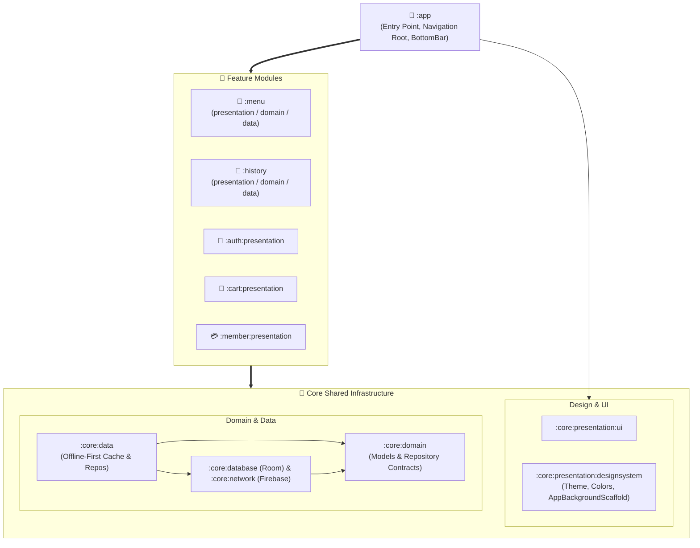

<p align="center">
  
</p>

<h1 align="center">🧋 Koalacha</h1>

<p align="center">
  <b>Gongcha Online Ordering & Digital Membership System</b>
</p>

<p align="center">
  <b>English</b> | <a href="README_zh.md">繁體中文</a> | <a href="README_ja.md">日本語</a>
</p>

<p align="center">
  <a href="https://www.android.com/"></a>
  <a href="https://kotlinlang.org"></a>
  <a href="https://developer.android.com/build"></a>
  <a href="https://developer.android.com/jetpack/compose"></a>
  
  <a href="https://firebase.google.com/"></a>
</p>

---

**Koalacha** is a modern Android beverage ordering and digital membership application developed following industry best practices. Built with **Multi-Module Clean Architecture**, **Offline-First synchronization**, and **Jetpack Compose (MVI)**, it delivers a seamless end-to-end experience featuring store selection, tea customization, shopping cart management, instant checkout, real-time order history tracking, and digital membership cards.

---

## 📑 Table of Contents

- [📸 Screenshots & Demo](#-screenshots--demo)
- [🏛 System Architecture](#-system-architecture)
- [🚀 Implemented Features](#-implemented-features)
- [🛠 Tech Stack & Libraries](#-tech-stack--libraries)
- [💾 Database & Offline-First Mechanism](#-database--offline-first-mechanism)
- [⚙️ Quick Start & Setup](#-quick-start--setup)
- [💡 Roadmap & Future Ideas](#-roadmap--future-ideas)

---

## 📸 Screenshots & Demo

### 🎬 App Demo Video

<div align="center">
  <a href="https://youtube.com/shorts/uP_M9odl3zg?feature=share" target="_blank">
    
  </a>
  <p><sub>▶️ <a href="https://youtube.com/shorts/uP_M9odl3zg?feature=share"><b>Watch Full App Demo on YouTube (YouTube Shorts)</b></a></sub></p>
</div>

### 📱 Core Feature Showcase

| Authentication & Guest Mode | Store Selection & Lock | Menu Browsing | Tea Customization |
| :---: | :---: | :---: | :---: |
|  |  |  |  |

| Cart & Instant Checkout | Order History Tracking | Order Status Chips |
| :---: | :---: | :---: |
|  |  |  |

| Digital Member Center | Membership Level Badges |
| :---: | :---: |
|  |  |

---

## 🏛 System Architecture

The project adopts a **Modular Clean Architecture (Presentation - Domain - Data)** with Gradle **Convention Plugins (`build-logic`)** for unified build configuration.

To balance architectural purity with developer productivity:
- **Full 3-Tier Features (`:menu`, `:history`)**: Complex domains maintain dedicated `presentation`, `domain`, and `data` submodules.
- **Focused UI Features (`:auth:presentation`, `:cart:presentation`, `:member:presentation`)**: Presentation-centric features directly consume shared `:core` domain contracts and repositories, eliminating unnecessary boilerplate.



### Module Responsibilities

| Module | Layer | Responsibility & Description |
| :--- | :--- | :--- |
| **`:app`** | Application | Application entry point, Splash screen, root navigation graph (`NavRoot`), Type-Safe routes, floating bottom navigation bar (`AppBottomBar`), and global cart item counter. |
| **`:menu`** | Feature (3-Tier) | Dedicated `presentation`, `domain`, and `data` modules handling store switching, tea catalog browsing, category filtering, customization, and Room/Firestore sync. |
| **`:history`** | Feature (3-Tier) | Dedicated `presentation`, `domain`, and `data` modules managing past order lists, status chips, order cancellations, and Firestore synchronization. |
| **`:cart:presentation`** | Feature (UI) | Cart presentation layer: user-scoped cart items (`userId`), live active store header sync, debounced quantity steppers (200ms), and checkout flow. |
| **`:member:presentation`** | Feature (UI) | Membership presentation layer: ZXing QR Code generator dialog, membership level cards (Bronze, Silver, Gold), tier benefits display, and reward points. |
| **`:auth:presentation`** | Feature (UI) | Authentication presentation layer: Google One-Tap via Android Credential Manager, theme-adaptive vector `GoogleSignInButton`, and anonymous guest sign-in. |
| **`:core:domain`** | Core Domain | Pure Kotlin domain layer: Core domain entities (`User`, `Tea`, `Store`, `CartItem`, `History`), `Result<D, E>`, `DataError`, and shared repository contracts. |
| **`:core:data`** | Core Data | Repository implementations: `OfflineFirstCartRepository`, preferences and store caching (`DefaultAppDataStore`), and `AuthRepositoryImpl`. |
| **`:core:database`** | Core Database | Room database engine: `GongchaDatabase`, DAOs, Type Converters, and automated database migrations (Migrations 1 to 5). |
| **`:core:network`** | Core Network | Remote network source: `FirebaseRemoteDataSource`, Cloud Firestore CRUD operations, and safe coroutine call wrappers (`safeFirebaseCall`). |
| **`:core:presentation:designsystem`** | Core Design | Design system: Artisanal Washi & Tea color palette, reusable `AppBackgroundScaffold` gradient layout, and `GongchaIcons` vector library. |
| **`:core:presentation:ui`** | Core UI | Common presentation utilities: UI models (`UiText`), reusable UI components (`Counter`, `NoticeCard`), and single-event observers (`ObserveAsEvents`). |
| **`build-logic`** | Build Logic | Gradle Convention Plugins composite build, centrally managing build scripts, Android configuration, Compose, Room, and dependencies. |

---

## 🚀 Implemented Features

### 1. Authentication & User Profile
- [x] **Google One-Tap Sign-In**: Integrated using Android Credential Manager and `google-id`, paired with an adaptive vector `GoogleSignInButton`.
- [x] **Anonymous Guest Access**: Instant browsing without sign-in via Firebase Anonymous Authentication.
- [x] **Secure Sign-Out Flow**: Flushes local cached credentials in DataStore, clears the navigation back stack (`popUpTo<AuthGraph> { inclusive = true }`), and redirects to login.
- [x] **User Data Synchronization**: Automatic synchronization of user profile, membership tier, and accumulated points with Cloud Firestore.

### 2. Stores & Menu System
- [x] **Store Switching & Persistence**: Browse stores by region and persist selected store in `AppDataStore`.
- [x] **Store Switch Lock**: Prevents accidental store changes when the cart contains items, displaying an alert dialog to protect order consistency.
- [x] **Unselected Store Prompt**: Intuitive visual cue guiding users to choose a store prior to ordering.
- [x] **Category Filter Chips**: Horizontally scrollable chips for fast beverage filtering (Original Tea, Milk Tea, Specialties, Slushes, etc.).
- [x] **Offline Cache Sync**: Version-checked (`versionCode`) incremental synchronization for lightning-fast startup and offline readiness.

### 3. Beverage Customization & Ordering
- [x] **Shared Element Transitions**: Smooth image zoom and seamless screen transitions between menu cards and the tea detail screen.
- [x] **Predictive Back Navigation**: Integrated Android 14+ `PredictiveBackHandler` for fluid back gestures.
- [x] **Comprehensive Customization**:
  - Cup Sizes: Medium (M) & Large (L) with dynamic pricing calculation.
  - Ice & Sugar: Regular / Less Ice / No Ice / Warm; Regular / Less Sugar / Half Sugar / Sugar Free.
  - Premium Toppings: Pearls, Coconut Jelly, Herbal Grass Jelly, Pudding, and more.
- [x] **Sticky Order Bottom Bar**: Live item subtotal calculation and one-click add to cart.

### 4. Shopping Cart & Checkout
- [x] **User-Scoped Cart**: Isolated cart records per authenticated user (`userId`) in Room database.
- [x] **Live Store Header Sync**: Dynamically displays the store name corresponding to the current cart.
- [x] **Bottom Bar Badge Counter**: Real-time item count indicator on the bottom navigation bar.
- [x] **Debounced Stepper Controls**: 200ms debounce window on quantity adjustments to prevent rapid duplicate writes.
- [x] **Item Removal Dialog**: Safe confirmation prompt before removing items.
- [x] **Batch Checkout Flow**: Bundles cart items into an atomic order written to Firestore and cleans the cart upon completion.

### 5. Order History Tracking
- [x] **Chronological Order List**: Orders sorted by creation date with order IDs, item breakdowns, and final totals.
- [x] **Order Status Chips**: Real-time visual status tags (`Pending / Brewing / Ready`).
- [x] **Order Cancellation**: In-app cancellation support for pending orders synchronized with Firestore.

### 6. Digital Membership Center
- [x] **Dynamic Member Cards**: Tier-specific gradient aesthetics and badges (Standard, Bronze, Silver, Gold).
- [x] **ZXing Member QR Code**: High-resolution QR Code generator dialog for contactless scanning in stores.
- [x] **Tier Perks & Progress**: Visual breakdown of current tier privileges, accumulated points, and threshold for the next tier.
- [x] **Guest Prompt State**: Clean `MemberNotLogin` placeholder guiding guest users to sign in.

### 7. Global Design System & Diagnostics
- [x] **Unified Gradient Scaffold**: Custom `AppBackgroundScaffold` providing an Artisanal Washi & Tea visual gradient across all screens.
- [x] **Full Dark / Light Theme Support**: Pixel-perfect contrast and color adaptations for both system modes.
- [x] **Structured Timber Logging**: Integrated `Timber.DebugTree()` in Debug builds across Network, Auth, and Application layers.

---

## 🛠 Tech Stack & Libraries

| Category | Technology / Library | Version / Details |
| :--- | :--- | :--- |
| **Language & Core** | **Kotlin** | `2.4.20`, Coroutines & StateFlow |
| **Platform** | **Android SDK** | Compile SDK: `37`, Target SDK: `37`, Min SDK: `24` |
| **Build System** | **AGP & Gradle** | AGP `9.4.1`, Version Catalogs, Convention Plugins |
| **UI Framework** | **Jetpack Compose** | Compose BOM `2026.09.00`, Material 3 |
| **Animations** | **Shared Element** | Compose `SharedTransitionLayout` |
| **Architecture** | **MVI + Clean Architecture** | StateFlow, Channel, Unidirectional Data Flow, Offline-First |
| **Dependency Injection** | **Koin** | `4.2.2` (`koin-android`, `koin-androidx-compose`, `koin-core`) |
| **Local Database** | **Room** | `2.8.5` (KSP `2.3.12`), Flow queries & Migrations 1 to 5 |
| **Preferences** | **DataStore Preferences** | `1.1.3`, Local store preferences and user caching |
| **Backend & Cloud** | **Firebase** | BoM `35.0.0` (Cloud Firestore, Firebase Authentication) |
| **Auth & Identity** | **Credential Manager** | `1.6.0`, `google-id:1.2.1` Google Authentication |
| **Image Loading** | **Coil Compose** | `2.7.0`, Async memory/disk caching |
| **QR Code Generation** | **ZXing Android** | `core:3.5.3`, Vector QR Code rendering |
| **Serialization** | **Kotlinx Serialization** | `1.11.0`, Type-Safe Navigation & Domain models |
| **Navigation** | **Navigation Compose** | `2.10.2`, Type-Safe Route objects & Nested graphs |
| **Logging** | **Timber** | `5.0.1`, Structured Debug logging |

---

## 💾 Database & Offline-First Mechanism

1. **Local-First Caching**: Beverage catalog and store data are served from Room database, ensuring zero network latency on view launch.
2. **Version-Driven Synchronization**: The client queries the `versions` Firestore collection and initiates background incremental synchronizations only when updates are detected.
3. **Room Database Migrations**:
   - `Migration 1 → 2`, `2 → 3`: Extended cart item customization attributes and schema fields.
   - `Migration 3 → 4`: Introduced `histories` table and `OrderStatus` TypeConverter.
   - `Migration 4 → 5`: Added foreign `userId` to cart entries, providing user data isolation.

---

## ⚙️ Quick Start & Setup

### Prerequisites
- Android Studio Ladybug / Meerkat or newer
- JDK 17 or 21
- Android SDK 37 (API 37)

### Build Instructions
1. **Clone Repository**
   ```bash
   git clone https://github.com/your-username/Gongcha.git
   cd Gongcha
   ```

2. **Configure Firebase & Initial Data**
   - Download `google-services.json` from your Firebase Console and place it into the `app/` folder (`app/google-services.json`).
   - Enable Firebase Authentication (Google Sign-In and Anonymous Auth).
   - Set up Cloud Firestore:
     - Pre-configured seed data is provided in the `firestore_data/` directory:
       - [`firestore_data/stores.json`](firestore_data/stores.json): Initial store listings, addresses, phone numbers, and business hours.
       - [`firestore_data/teas.json`](firestore_data/teas.json): Complete beverage catalog, multilingual descriptions, categories, pricing, and image URLs.
     - Import or initialize documents in the `stores` and `teas` collections in Cloud Firestore using these JSON files.
     - Also create `versions` (containing an integer `versionCode` field to trigger cache sync) and `users` collections.

3. **Set Web Client ID**
   - Specify your Google Web Client ID in `local.properties`:
     ```properties
     WEB_CLIENT_ID="your-google-web-client-id.apps.googleusercontent.com"
     ```

4. **Build and Run**
   ```bash
   ./gradlew assembleDebug
   ```

---

## 💡 Roadmap & Future Ideas

- 📍 **LBS Store Recommendation**: Calculate distance to nearest stores using Google Maps SDK and FusedLocationProviderClient.
- 💳 **Google Pay & Mobile Payments**: Seconds-fast checkout via Google Pay API and local payment gateways.
- 🎟️ **Coupons & Promotional Vouchers**: Membership promotional codes (Buy 1 Get 1, discount vouchers).
- 🔔 **FCM Live Push Notifications**: Push updates when orders transition from Brewing to Ready.
- ⏱️ **Lock Screen & Glance Widgets**: Glance AppWidget showing order queue status and estimated pickup time.
- ❤️ **Favorites & Quick Reorder**: One-click repeat order for saved custom recipes.

---

*Made with ❤️ for tea lovers everywhere.*
