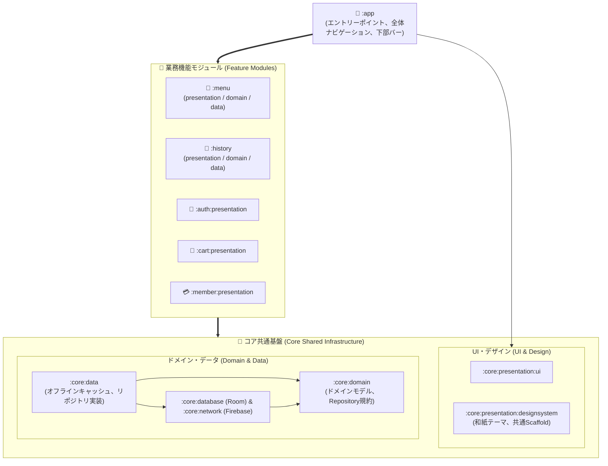

<p align="center">
  
</p>

<h1 align="center">🧋 Koalacha</h1>

<p align="center">
  <b>Gongcha オンライン注文＆デジタル会員システム</b>
</p>

<p align="center">
  <a href="README.md">English</a> | <a href="README_zh.md">繁體中文</a> | <b>日本語</b>
</p>

<p align="center">
  <a href="https://www.android.com/"></a>
  <a href="https://kotlinlang.org"></a>
  <a href="https://developer.android.com/build"></a>
  <a href="https://developer.android.com/jetpack/compose"></a>
  
  <a href="https://firebase.google.com/"></a>
</p>

---

**Koalacha** は、最新の Android アーキテクチャ設計標準に基づいて開発されたティードリンクのオンライン注文およびデジタル会員アプリです。**マルチモジュール・クリーンアーキテクチャ**、**オフラインファースト（Offline-First）** 同期、**Jetpack Compose（MVI パターン）** を採用し、店舗選択、ドリンクカスタマイズ、カート管理、即時注文決済、リアルタイム注文履歴追跡、デジタル会員証サービスを提供します。

---

## 📑 目次

- [📸 スクリーンショット＆デモ (Screenshots & Demo)](#-スクリーンショットデモ-screenshots--demo)
- [🏛 システムアーキテクチャ設計](#-システムアーキテクチャ設計)
- [🚀 実装済み機能一覧](#-実装済み機能一覧)
- [🛠 技術スタック＆ライブラリ](#-技術スタックライブラリ)
- [💾 データベースとオフライン同期機構](#-データベースとオフライン同期機構)
- [⚙️ クイックスタートと環境構築](#-クイックスタートと環境構築)
- [💡 今後のロードマップと拡張アイデア](#-今後のロードマップと拡張アイデア)

---

## 📸 スクリーンショット＆デモ (Screenshots & Demo)

### 🎬 アプリ操作デモ動画 (Demo Video)

<div align="center">
  <a href="https://youtube.com/shorts/uP_M9odl3zg?feature=share" target="_blank">
    
  </a>
  <p><sub>▶️ <a href="https://youtube.com/shorts/uP_M9odl3zg?feature=share"><b>YouTube でアプリデモ動画を視聴する (YouTube Shorts)</b></a></sub></p>
</div>

### 📱 主要画面ギャラリー (Core Features)

| ログイン＆ゲストモード | 店舗選択・保護ロック | メニュー閲覧 | ドリンクカスタマイズ |
| :---: | :---: | :---: | :---: |
|  |  |  |  |

| カート管理＆決済 | 注文履歴追跡 | 注文ステータスチップ |
| :---: | :---: | :---: |
|  |  |  |

| デジタル会員センター | 会員ランクラベル |
| :---: | :---: |
|  |  |

---

## 🏛 システムアーキテクチャ設計

本プロジェクトは、Gradle の **Convention Plugins (`build-logic`)** による統一管理のもと、**マルチモジュール Clean Architecture (Presentation - Domain - Data)** を採用しています。

アーキテクチャの明瞭性と開発効率のバランスを図るため、業務の複雑度に応じたモジュール設計を実施しています：
- **完全3層構造機能 (`:menu`, `:history`)**：業務ロジックが多岐にわたる機能は、独立した `presentation`、`domain`、`data` サブモジュールを維持。
- **UI特化機能 (`:auth:presentation`, `:cart:presentation`, `:member:presentation`)**：画面表示とインタラクションに特化し、`:core` 共通層のリポジトリやドメイン契約を直接利用することでボイラープレートを排除。



### モジュール役割詳細

| モジュール名 | 分類 | 役割と責務 |
| :--- | :--- | :--- |
| **`:app`** | Application | アプリケーションのエントリーポイント、スプラッシュ画面、全体ナビゲーショングラフ（`NavRoot`、Type-Safe Routes）、フローティング下部ナビゲーションバー（`AppBottomBar`）、グローバルカート数量監視。 |
| **`:menu`** | Feature (完全3層) | 店舗選択、メニュー閲覧、カスタマイズ（氷・甘さ・トッピング・サイズ）、カート追加、Room/Firestore 差分同期を担う `presentation`, `domain`, `data` モジュール群。 |
| **`:history`** | Feature (完全3層) | 過去の注文履歴表示、ステータスチップ、注文キャンセル、Firestore 状態同期を担う `presentation`, `domain`, `data` モジュール群。 |
| **`:cart:presentation`** | Feature (UI) | カート画面：`userId` によるユーザー別カート分離、アクティブ店舗ヘッダー同期、200ms デバウンス付き数量変更、削除確認ダイアログ、決済処理。 |
| **`:member:presentation`** | Feature (UI) | 会員画面：ZXing による会員 QR コードダイアログ生成、会員ランクカード（通常・ブロンズ・シルバー・ゴールド）、ランク特典案内、獲得ポイント表示。 |
| **`:auth:presentation`** | Feature (UI) | 認証画面：Credential Manager による Google ワンタップログイン、明暗適応ベクター `GoogleSignInButton`、匿名ゲストログイン（Anonymous Auth）。 |
| **`:core:domain`** | Core Domain | 純粋 Kotlin ドメイン層：コアドメインエンティティ（`User`, `Tea`, `Store`, `CartItem`, `History` など）、`Result<D, E>`、`DataError`、共通リポジトリ規約。 |
| **`:core:data`** | Core Data | コアデータ層実装：オフラインファースト `OfflineFirstCartRepository`、設定および店舗キャッシュ `DefaultAppDataStore`、`AuthRepositoryImpl`。 |
| **`:core:database`** | Core Database | Room データベースエンジン：`GongchaDatabase`、DAO、型コンバーター、自動マイグレーションスクリプト（Migrations 1 → 5）。 |
| **`:core:network`** | Core Network | リモートデータソース：`FirebaseRemoteDataSource`、Cloud Firestore の CRUD 操作、コルーチンセーフ例外マッピング（`safeFirebaseCall`）。 |
| **`:core:presentation:designsystem`** | Core Design | デザインシステム：和紙と茶を基調としたカラーパレット、共通グラデーション背景レイアウト `AppBackgroundScaffold`、`GongchaIcons` ベクターアイコン集。 |
| **`:core:presentation:ui`** | Core UI | 共通 UI ユーティリティ：UI モデル（`UiText`）、共通コンポーネント（`Counter`, `NoticeCard`）、単一イベント監視ツール（`ObserveAsEvents`）。 |
| **`build-logic`** | Build Logic | Gradle Convention Plugins 複合ビルド（Composite Builds）：Application / Library / Compose / Room のビルド設定と依存関係バージョンを一元管理。 |

---

## 🚀 実装済み機能一覧

### 1. ユーザー認証とプロフィール管理 (Authentication & User Profile)
- [x] **Google ワンタップログイン**：最新の Android `Credential Manager` および `google-id` と連携し、明暗テーマ適応のベクターボタン `GoogleSignInButton` を搭載。
- [x] **匿名ゲストログイン**：会員登録不要で即座にアプリを閲覧・試用可能（Firebase Anonymous Auth）。
- [x] **安全なログアウト機構**：ログアウト時に DataStore キャッシュを破棄し、バックスタックを全消去（`popUpTo<AuthGraph> { inclusive = true }`）してログイン画面へ安全に戻る。
- [x] **ユーザーデータ同期**：ログイン時に Firestore から名前、アイコン、会員ランク、ポイント情報を自動同期。

### 2. 店舗とメニューシステム (Stores & Menu)
- [x] **リアルタイム店舗選択と永続化**：エリア別店舗リストを表示し、最後に選択した店舗を保存（`AppDataStore`）。
- [x] **店舗切り替え保護ロック**：カートに商品が入っている間は店舗の誤変更を制限し、確認ダイアログを表示して注文の混同を防止。
- [x] **店舗未選択ガイド**：店舗が未選択の状態でドリンクを選択した際のアニメーション誘導。
- [x] **カテゴリフィルターチップ**：横スクロール可能なチップで瞬時にドリンクを絞り込み（ストレートティー、ミルクティー、フルーツティー、スムージー等）。
- [x] **オフライン同期機構**：バージョン番号（`versionCode`）を比較し、更新時のみ増量同期を実行して起動を高速化。

### 3. ドリンクカスタマイズと注文 (Tea Order Customization)
- [x] **共有要素トランジション (Shared Element Transition)**：メニュー一覧から詳細画面への滑らかな画像拡大・遷移アニメーション。
- [x] **予測型「戻る」ジェスチャー (Predictive Back)**：Android 14+ の `PredictiveBackHandler` を組み込み、直感的でスムーズな画面復帰を実現。
- [x] **豊富なカスタマイズ設定**：
  - サイズ：Mサイズ / Lサイズ（価格が動的に連動）。
  - 氷の量・甘さ：標準 / 微氷 / 氷なし / ホット；標準 / 控えめ / 微糖 / 無糖。
  - トッピング：タピオカ、ナタデココ、仙草ゼリー、プリンなど複数選択可能。
- [x] **注文バー (Order Bottom Bar)**：リアルタイムに合計金額を計算し、1タップでカートへ追加。

### 4. カート管理と注文決済 (Cart & Checkout)
- [x] **ユーザー別カート分離**：Room データベース上で `userId` を用いてアカウントごとのカートデータを完全分離。
- [x] **アクティブ店舗ヘッダー同期**：カート画面上部に現在の注文店舗情報をリアルタイム表示。
- [x] **バッジカウンター通知**：下部ナビゲーションバーのカートアイコンに現在の合計点数をリアルタイム反映。
- [x] **デバウンス付き数量変更**：数量の増減ボタンに 200ms のデバウンスを実装し、連続タップによる不要な DB 書き込みを防止。
- [x] **削除確認ダイアログ**：誤操作を防ぐ個別商品の削除確認ポップアップ。
- [x] **ワンタップ決済**：カート内の商品を単一の注文データとして Firestore へ一括送信し、完了後にカートを自動クリア。

### 5. 注文履歴の追跡 (Order History)
- [x] **時系列注文リスト**：作成日時降順で注文番号、商品リスト、支払い合計額を一覧表示。
- [x] **注文ステータスチップ (Status Chip)**：注文状態を視覚的に把握（`受付待ち / 調理中 / 完成`）。
- [x] **注文キャンセル機能**：未完了の注文についてアプリ内からキャンセルリクエストを送信可能。

### 6. デジタル会員センター (Member Center)
- [x] **会員ランクカード表示**：ランクに応じたグラデーションカラーとバッジ（通常、ブロンズ、シルバー、ゴールド）。
- [x] **会員専用 QR コード**：ZXing を統合し、店頭スキャン用の高精度 QR コードダイアログを動的生成。
- [x] **会員特典とランク進捗**：現在のランク特典、累積ポイント、次ランクまでの必要利用金額を可視化。
- [x] **未ログイン状態の案内**：未ログイン時は `MemberNotLogin` 画面を表示し、ログインへ自然に誘導。

### 7. 全体デザインシステム＆ロギング (Design System & Diagnostics)
- [x] **統一グラデーション Scaffold**：共通コンポーネント `AppBackgroundScaffold` により、全画面で和紙とお茶を基調とした美しい背景を適用。
- [x] **ダーク・ライトテーマ完全対応**：システムのカラーモードに合わせて自動で最適なコントラストと配色を調整。
- [x] **Timber 構造化ロギング**：Debug ビルド時に `Timber.DebugTree()` を自動組み込み、通信・認証・初期化ログを一元化。

---

## 🛠 技術スタック＆ライブラリ

| 分類 | 技術 / ライブラリ | バージョン / 備考 |
| :--- | :--- | :--- |
| **開発言語** | **Kotlin** | `2.4.20`、Coroutines & StateFlow を全面採用 |
| **プラットフォーム** | **Android SDK** | Compile SDK: `37`, Target SDK: `37`, Min SDK: `24` |
| **ビルドシステム** | **AGP & Gradle** | AGP `9.4.1`, Version Catalogs, Convention Plugins |
| **UI フレームワーク** | **Jetpack Compose** | Compose BOM `2026.09.00`, Material 3 |
| **アニメーション** | **Shared Element** | Compose `SharedTransitionLayout` |
| **アーキテクチャ** | **MVI + Clean Architecture** | StateFlow, Channel, 単方向データフロー, Offline-First |
| **DI (依存性注入)** | **Koin** | `4.2.2` (`koin-android`, `koin-androidx-compose`, `koin-core`) |
| **ローカル DB** | **Room** | `2.8.5` (KSP `2.3.12`), Flow クエリ & マイグレーション (1 to 5) |
| **設定値保存** | **DataStore Preferences** | `1.1.3`、店舗状態とユーザー情報キャッシュ |
| **クラウド・バックエンド** | **Firebase** | BoM `35.0.0` (Cloud Firestore, Firebase Authentication) |
| **認証** | **Credential Manager** | `1.6.0`, `google-id:1.2.1` Google 認証統合 |
| **画像読み込み** | **Coil Compose** | `2.7.0`、非同期画像キャッシュとメモリ最適化 |
| **QR コード生成** | **ZXing Android** | `core:3.5.3`、会員バーコード・QR 生成 |
| **シリアライズ** | **Kotlinx Serialization** | `1.11.0`、型安全ナビゲーションおよびデータモデル |
| **ナビゲーション** | **Navigation Compose** | `2.10.2`、型安全ルートオブジェクトとサブグラフ |
| **ロギング** | **Timber** | `5.0.1`、構造化 Debug ログ |

---

## 💾 データベースとオフライン同期機構

1. **ローカルファースト（Local-First）表示**：メニューのドリンクと店舗データは Room データベースから優先的に読み込まれるため、起動時や画面遷移時のロード遅延がありません。
2. **バージョン駆動同期**：Firestore の `versions` コレクションを参照し、遠隔データに変更があった場合のみバックグラウンドで差分同期を行います。
3. **Room Database Migrations**：
   - `Migration 1 → 2`, `2 → 3`：カートアイテムのカスタマイズ項目の拡張。
   - `Migration 3 → 4`：注文履歴テーブル `histories` と `OrderStatus` コンバーターの追加。
   - `Migration 4 → 5`：カートテーブルに `userId` を追加し、マルチアカウント間のデータ完全分離を実現。

---

## ⚙️ クイックスタートと環境構築

### 必要な環境
- Android Studio Ladybug / Meerkat 以降
- JDK 17 または 21
- Android SDK 37 (API 37)

### セットアップ手順
1. **リポジトリをクローン**
   ```bash
   git clone https://github.com/your-username/Gongcha.git
   cd Gongcha
   ```

2. **Firebase の設定と初期データ**
   - Firebase Console から `google-services.json` をダウンロードし、`app/` ディレクトリに配置します（`app/google-services.json`）。
   - Firebase Authentication で「Google サインイン」と「匿名認証」を有効化します。
   - Cloud Firestore のコレクション作成と初期データ登録：
     - 本プロジェクトには `firestore_data/` ディレクトリ配下に初期データ JSON が同梱されています：
       - [`firestore_data/stores.json`](firestore_data/stores.json)：店舗情報、住所、電話番号、営業時間。
       - [`firestore_data/teas.json`](firestore_data/teas.json)：ドリンクメニュー一覧、多言語（日・英・中）表記、分類、価格、商品画像 URL。
     - 上記 JSON ファイルを利用して、Firestore の `stores` および `teas` コレクションに初期データを登録してください。
     - 差分同期を制御する `versions` コレクション（整数値の `versionCode` 属性）および `users` コレクションも併せて作成します。

3. **Web Client ID の設定**
   - `local.properties` に Google Web Client ID を設定します：
     ```properties
     WEB_CLIENT_ID="your-google-web-client-id.apps.googleusercontent.com"
     ```

4. **ビルドと実行**
   ```bash
   ./gradlew assembleDebug
   ```

---

## 💡 今後のロードマップと拡張アイデア

- 📍 **現在地に基づく最寄り店舗推薦 (LBS)**：Google Maps SDK および FusedLocationProviderClient を活用し、現在地からの距離を自動計算してソート。
- 💳 **Google Pay / スマホ決済連携**：Google Pay API や各種キャッシュレス決済を導入し、スムーズな会計を実現。
- 🎟️ **クーポン・キャンペーン機能**：1杯無料クーポンや割引コードの適用機能。
- 🔔 **FCM プッシュ通知 (リアルタイムステータス)**：ドリンクの作成完了・受け取り準備完了を自動通知。
- ⏱️ **Glance ウィジェット対応**：Android ホーム画面ウィジェットで注文の進捗状況と受取予定時間を常時確認。
- ❤️ **お気に入り登録・クイックリピート**：好みのカスタマイズを保存し、1タップで同じドリンクを再注文。

---

*Made with ❤️ for tea lovers everywhere.*
