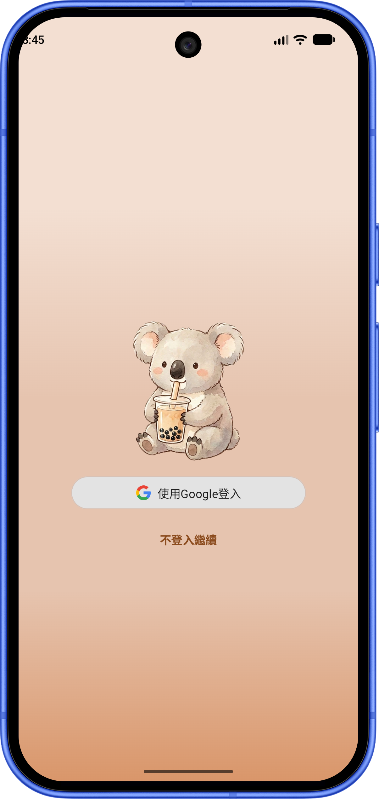
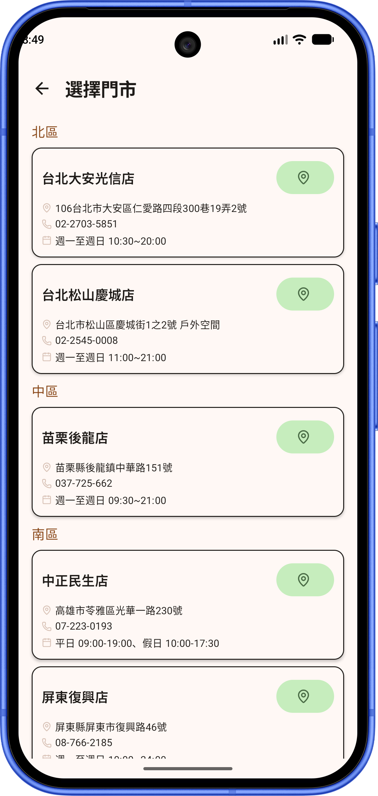
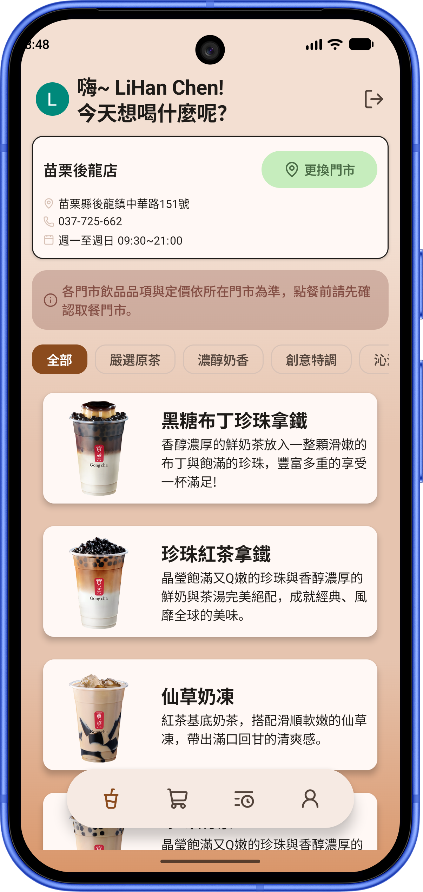
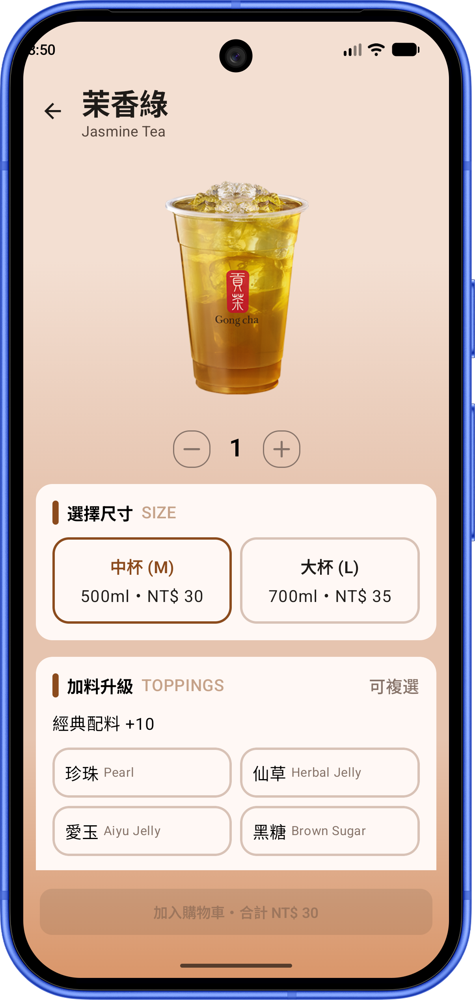
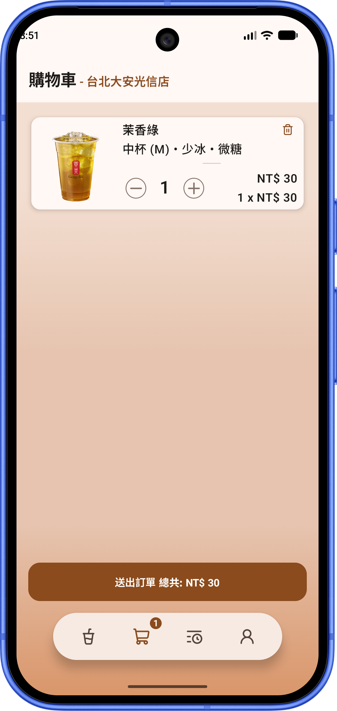
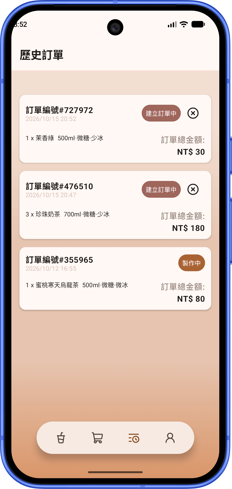
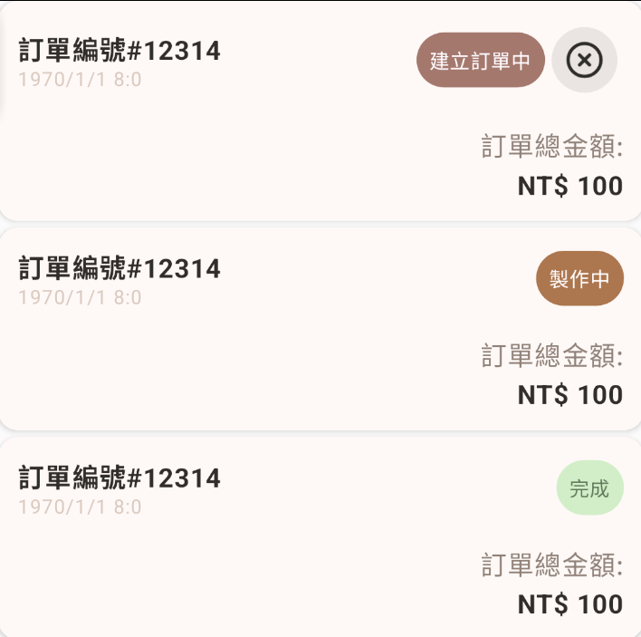
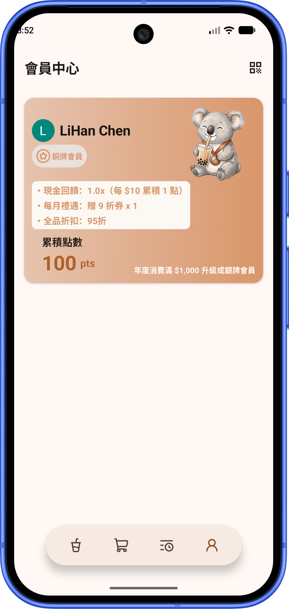
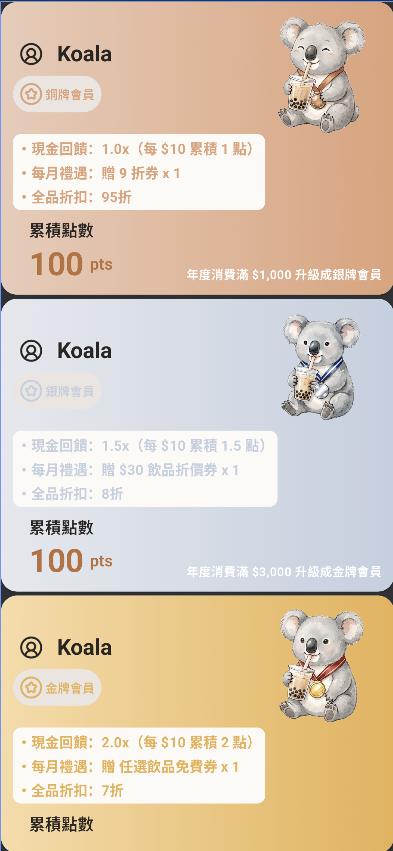
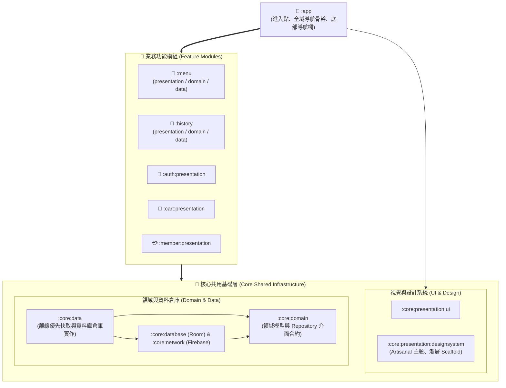

<p align="center">
  
</p>

<h1 align="center">🧋 Koalacha</h1>

<p align="center">
  <b>Gongcha 貢茶線上點餐與數位會員系統</b>
</p>

<p align="center">
  <a href="README.md">English</a> | <b>繁體中文</b> | <a href="README_ja.md">日本語</a>
</p>

<p align="center">
  <a href="https://www.android.com/"></a>
  <a href="https://kotlinlang.org"></a>
  <a href="https://developer.android.com/build"></a>
  <a href="https://developer.android.com/jetpack/compose"></a>
  
  <a href="https://firebase.google.com/"></a>
</p>

---

**Koalacha** 是一款遵循現代 Android 開發架構規範打造的手搖飲線上點餐與數位會員 App。採用 **Multi-Module Clean Architecture**、**離線優先（Offline-First）** 策略與 **Jetpack Compose (MVI)**，提供門市選擇、飲品自訂、購物車管理、即時結帳、歷史訂單追蹤與數位會員卡服務。

---

## 📑 目錄

- [📸 畫面預覽與展示 (Screenshots & Demo)](#-畫面預覽與展示-screenshots--demo)
- [🏛 系統模組架構設計](#-系統模組架構設計)
- [🚀 已實現功能清單](#-已實現功能清單)
- [🛠 技術棧與函式庫](#-技術棧與函式庫)
- [💾 資料庫與離線同步機制](#-資料庫與離線同步機制)
- [⚙️ 快速開始與環境設置](#-快速開始與環境設置)
- [💡 未來擴充與功能建議 (Roadmap & Ideas)](#-未來擴充與功能建議-roadmap--ideas)

---

## 📸 畫面預覽與展示 (Screenshots & Demo)

### 🎬 操作展示影片 (Demo Video)

<div align="center">
  <a href="https://youtube.com/shorts/uP_M9odl3zg?feature=share" target="_blank">
    
  </a>
  <p><sub>▶️ <a href="https://youtube.com/shorts/uP_M9odl3zg?feature=share"><b>在 YouTube 上觀看完整操作展示 (YouTube Shorts)</b></a></sub></p>
</div>

### 📱 核心功能畫面 (Core Features)

| 登入與訪客模式 | 門市切換與保護 | 菜單分類與瀏覽 | 飲品客製化點餐 |
| :---: | :---: | :---: | :---: |
|  |  |  |  |

| 購物車管理與結帳 | 歷史訂單追蹤 | 訂單狀態標籤 |
| :---: | :---: | :---: |
|  |  |  |

| 數位會員中心 | 會員等級卡面視覺 |
| :---: | :---: |
|  |  |

---

## 🏛 系統模組架構設計

專案採用 **模組化 Clean Architecture (Presentation - Domain - Data)**，搭配 Gradle **Convention Plugins (`build-logic`)** 統一建置規範。

為兼顧架構清晰性與開發維護效率，本專案依業務複雜度進行分層劃分：
- **完整三層業務模組 (`:menu`, `:history`)**：業務繁複的領域維護獨立的 `presentation`、`domain` 與 `data` 子模組。
- **輕量介面模組 (`:auth:presentation`, `:cart:presentation`, `:member:presentation`)**：專注於 UI 與使用者互動，直接取用 `:core` 共用層領域合約與資料倉庫，免除冗餘的樣板轉接程式碼。



### 模組職責說明

| 模組名稱 | 層級分類 | 職責與描述 |
| :--- | :--- | :--- |
| **`:app`** | Application | 應用程式進入點、啟動畫面（Splash Screen）、全局導航骨幹（`NavRoot`、Type-Safe Routes）、浮動底部導航欄（`AppBottomBar`）與全域購物車計數監聽。 |
| **`:menu`** | Feature (完整三層) | 包含獨立之 `presentation`、`domain` 與 `data` 模組：負責門市選取、菜單分類瀏覽、飲品規格客製化、加入購物車與 Room / Firestore 增量快取同步。 |
| **`:history`** | Feature (完整三層) | 包含獨立之 `presentation`、`domain` 與 `data` 模組：負責歷史訂單列表、動態訂單狀態晶片、取消訂單機制與遠端 Firestore 狀態同步。 |
| **`:cart:presentation`** | Feature (UI) | 購物車呈現層：依 `userId` 隔離購物車品項、即時門市標題同步、數量增減防抖（200ms Debounce）、單品刪除彈窗與一鍵結帳流程。 |
| **`:member:presentation`** | Feature (UI) | 數位會員呈現層：ZXing 會員條碼生成彈窗、會員等級卡面（無等級/銅/銀/金牌視覺）、等級專屬權益說明、累積點數展示與未登入導引。 |
| **`:auth:presentation`** | Feature (UI) | 身份認證呈現層：Credential Manager Google 一鍵登入、自適應深淺色向量 `GoogleSignInButton`、訪客匿名登入（Anonymous Auth）。 |
| **`:core:domain`** | Core Domain | 純 Kotlin 領域層：定義核心領域實體（`User`, `Tea`, `Store`, `CartItem`, `History` 等）、`Result<D, E>`、`DataError` 與各通用 Repository 介面。 |
| **`:core:data`** | Core Data | 核心資料層實作：離線優先資料流 `OfflineFirstCartRepository`、使用者偏好設定 `DefaultAppDataStore`、`AuthRepositoryImpl`。 |
| **`:core:database`** | Core Database | Room 資料庫引擎：`GongchaDatabase`、DAO、型別轉換器、完整版本遷移腳本（Migrations 1 → 5）。 |
| **`:core:network`** | Core Network | 雲端資料來源：`FirebaseRemoteDataSource`，封裝 Cloud Firestore CRUD 操作、安全例外轉換（`safeFirebaseCall`）。 |
| **`:core:presentation:designsystem`** | Core Design | 設計系統：Artisanal Washi & Tea 配色、自適應漸層背景元件 `AppBackgroundScaffold`、向量圖標庫（`GongchaIcons`）、按鈕與樣式。 |
| **`:core:presentation:ui`** | Core UI | 通用 UI 支援：UI 模型（`UiText`）、共用元件（`Counter`, `NoticeCard`）與事件監聽工具（`ObserveAsEvents`）。 |
| **`build-logic`** | Build Logic | Gradle Convention Plugins 複合建置（Composite Builds），統一管理 Application、Library、Compose、Room 插件及依賴版本。 |

---

## 🚀 已實現功能清單

### 1. 身份認證與用戶管理 (Authentication & User Profile)
- [x] **Google 一鍵登入**：基於 Android 最新 `Credential Manager` 與 `google-id`，搭配自適應深淺色向量按鈕 `GoogleSignInButton`。
- [x] **訪客匿名登入**：支援免登入快速瀏覽，自動建置匿名 Firebase 訪客身分。
- [x] **安全登出機制**：登出時清除 DataStore 本地快取、清空導航返回棧（`popUpTo<AuthGraph> { inclusive = true }`）並重定向至登入畫面。
- [x] **使用者資料隔離**：登入後自動同步 Firestore 用戶資料（名稱、頭像、等級、點數）。

### 2. 門市與菜單系統 (Stores & Menu)
- [x] **門市即時切換與持久化**：支援分區門市列表展示，記住最新選擇門市（`AppDataStore`）。
- [x] **切換門市保護鎖**：當購物車內尚有商品時，限制任意切換門市並彈出確認對話框，避免訂單跨門市混淆。
- [x] **未選門市提示動畫**：未選取門市時點選飲品觸發提示與引導動態。
- [x] **飲品分類篩選**：以可滑動 Chips 依類別篩選（原茶、奶香、特調、冰沙等）。
- [x] **離線快取同步機制**：以版本號（`versionCode`）比對機制進行增量同步，加速載入並支援無網路瀏覽。

### 3. 飲品客製化與點餐 (Tea Order Customization)
- [x] **共享元素轉場（Shared Element Transition）**：飲品卡片至點餐頁面使用平滑放大與過渡動畫。
- [x] **預測性返回手勢（Predictive Back）**：整合 Android 14+ `PredictiveBackHandler`，點餐頁手勢返回滑順自然。
- [x] **豐富客製化選項**：
  - 規格尺寸：中杯（M）、大杯（L），價格動態連動。
  - 冰塊甜度：正常冰 / 微冰 / 去冰 / 溫熱；全糖 / 半糖 / 微糖 / 無糖。
  - 加料選單：珍珠、椰果、仙草、布丁等多選加料，即時計算額外加價。
- [x] **數量調整與加入購物車**：底部即時計價訂購列（`OrderBottomBar`），一鍵加入購物車。

### 4. 購物車與結帳 (Cart & Checkout)
- [x] **用戶專屬購物車**：Room 資料庫以 `userId` 隔離各帳號購物車項目。
- [x] **即時門市連動**：購物車頂部即時顯示當前訂單所屬門市資訊（`selectedStore`）。
- [x] **即時徽章通知**：底部導航欄即時連動顯示購物車商品總數量 Badge。
- [x] **防抖數量增減**：加減按鈕內建 200ms Debounce 防抖，避免連續點擊頻繁寫入資料庫。
- [x] **單品刪除對話框**：友善確認彈窗，支援單項刪除。
- [x] **多品項一鍵結帳**：自動將購物車品項打包為單筆訂單寫入 Firestore，完成後清空購物車。

### 5. 訂單歷程追蹤 (Order History)
- [x] **歷史訂單列表**：依建立時間倒序排列，列出訂單編號、品項清單與實付總額。
- [x] **狀態標籤晶片（Status Chip）**：即時識別訂單狀態（`待接單 / 製作中 / 已完成`）。
- [x] **取消訂單支援**：訂單未完成前支援取消操作並同步遠端 Firestore。

### 6. 數位會員專區 (Member Center)
- [x] **會員卡面視覺**：依等級動態呈現卡面漸層色彩與專屬徽章（無等級、銅牌、銀牌、金牌）。
- [x] **專屬 QR Code / 條碼**：整合 ZXing 生成專屬會員 QRCode 彈出對話框，便於實體門市掃描。
- [x] **會員等級與權益說明**：動態展示當前等級特權、累積點數及距離下一等級所需消費金額。
- [x] **未登入狀態提示**：未登入時以 `MemberNotLogin` 引導使用者進行登入。

### 7. 全域視覺與日誌 (Design System & Diagnostics)
- [x] **統一漸層 Scaffold**：打造 `AppBackgroundScaffold`，全 App 各功能頁面皆套用自適應 Artisanal Washi & Tea 深淺色漸層。
- [x] **日夜間模式支援**：所有元件均相容深色主題與淺色主題色彩規範。
- [x] **Timber 結構化日誌**：於 Debug 模式自動掛載 `Timber.DebugTree()`，涵蓋網路、認證與 App 初始化日誌。

---

## 🛠 技術棧與函式庫

| 類別 | 技術 / 函式庫 | 版本 / 說明 |
| :--- | :--- | :--- |
| **語言與核心** | **Kotlin** | `2.4.20`，全面採用 Coroutines & Flow |
| **Android 平台** | **Android SDK** | Compile SDK: `37`, Target SDK: `37`, Min SDK: `24` |
| **建置系統** | **AGP & Gradle** | AGP `9.4.1`, Gradle Version Catalogs, Convention Plugins |
| **UI 框架** | **Jetpack Compose** | Compose BOM `2026.09.00`, Material 3 |
| **動畫與轉場** | **Shared Element** | Compose `SharedTransitionLayout` 共享轉場 |
| **架構模式** | **MVI + Clean Architecture** | StateFlow, Channel (Single Event), Action, Offline-First |
| **依賴注入** | **Koin** | `4.2.2` (`koin-android`, `koin-androidx-compose`, `koin-core`) |
| **本地資料庫** | **Room** | `2.8.5` (KSP `2.3.12`), 支援 Flow 與 Migrations (1 to 5) |
| **偏好儲存** | **DataStore Preferences** | `1.1.3`，儲存門市狀態與用戶資訊快取 |
| **雲端後端** | **Firebase** | BoM `35.0.0` (Cloud Firestore, Firebase Authentication) |
| **憑證與登入** | **Credential Manager** | `1.6.0`, `google-id:1.2.1` 現代 Google 授權整合 |
| **圖片載入** | **Coil Compose** | `2.7.0`，非同步圖片快取與圓形轉場渲染 |
| **條碼生成** | **ZXing Android** | `core:3.5.3`，即時渲染會員專屬 QR Code |
| **序列化** | **Kotlinx Serialization** | `1.11.0`，配合 Type-Safe Navigation 與資料模型 |
| **導航元件** | **Navigation Compose** | `2.10.2`，支援型別安全 Route 與 Sub-graphs |
| **日誌偵錯** | **Timber** | `5.0.1`，結構化 Debug 偵錯日誌 |

---

## 💾 資料庫與離線同步機制

本專案實作了嚴謹的 **Offline-First（離線優先）** 機制：
1. **本地快取優先顯示**：菜單飲品與門市資料優先由 Room 本地讀取，UI 瞬間載入不卡頓。
2. **版本號比對（Version Check）**：由 `core:network` 向 Firestore `versions` 集合查詢版本號，僅在遠端有異動時才在背景觸發增量同步。
3. **Room Database Migrations**：
   - `Migration 1 → 2`、`2 → 3`：擴充購物車品項客製化選項與欄位。
   - `Migration 3 → 4`：新增歷史訂單資料表 `histories` 與 `OrderStatus` 轉換器。
   - `Migration 4 → 5`：購物車商品新增 `userId` 外鍵邏輯，達成多帳號切換數據隔離。

---

## ⚙️ 快速開始與環境設置

### 必備環境
- Android Studio Ladybug / Meerkat 或更高版本
- JDK 17 或 21
- Android SDK 37 (API 37)

### 建置步驟
1. **Clone 專案**
   ```bash
   git clone https://github.com/your-username/Gongcha.git
   cd Gongcha
   ```

2. **配置 Firebase 與初始資料**
   - 將在 Firebase Console 取得的 `google-services.json` 放置於 `app/` 目錄下（`app/google-services.json`）。
   - 於 Firebase 控制台啟用 Firebase Authentication（Google 登入與 Anonymous 匿名登入）。
   - 建立 Cloud Firestore 集合並匯入初始資料：
     - 本專案於 `firestore_data/` 目錄下提供完整的預設資料範本：
       - [`firestore_data/stores.json`](firestore_data/stores.json)：門市列表、地址、電話與營業時間。
       - [`firestore_data/teas.json`](firestore_data/teas.json)：完整飲品菜單、中英文品名、分類、冰熱/糖度選項、價格與圖片連結。
     - 可利用上述 JSON 檔案批次匯入或建立 Firestore 的 `stores` 與 `teas` 集合資料。
     - 另外建立 `versions`（包含整數 `versionCode` 欄位以驅動版本檢查快取同步）與 `users` 集合。

3. **配置 Web Client ID**
   - 於 `local.properties` 設定你的 Google Web Client ID：
     ```properties
     WEB_CLIENT_ID="your-google-web-client-id.apps.googleusercontent.com"
     ```

4. **編譯並運行**
   ```bash
   ./gradlew assembleDebug
   ```

---

## 💡 未來擴充與功能建議 (Roadmap & Ideas)

- 📍 **LBS 定位推薦最近門市**：整合 Google Maps SDK / FusedLocationProviderClient，自動計算距離並依近至遠排序。
- 💳 **Google Pay / 行動支付**：整合 Google Pay API 或第三方金流（LINE Pay、街口支付），提供秒速結帳。
- 🎟️ **優惠券（Coupons）系統**：結帳時可套用折扣碼或會員專屬優惠券（如「買一送一」、「滿百折十」）。
- 🔔 **FCM 推播通知（Firebase Cloud Messaging）**：當飲品製作完成、可前往取餐時，主動發送推播通知。
- ⏱️ **Live Updates / 鎖定螢幕小工具**：利用 Android Glance 製作桌面小工具，即時查看取餐進度。
- ❤️ **我的最愛與「再點一次」**：一鍵將客製化組合存入最愛，或在歷史訂單一鍵「再來一杯」。

---

*Made with ❤️ for tea lovers everywhere.*
